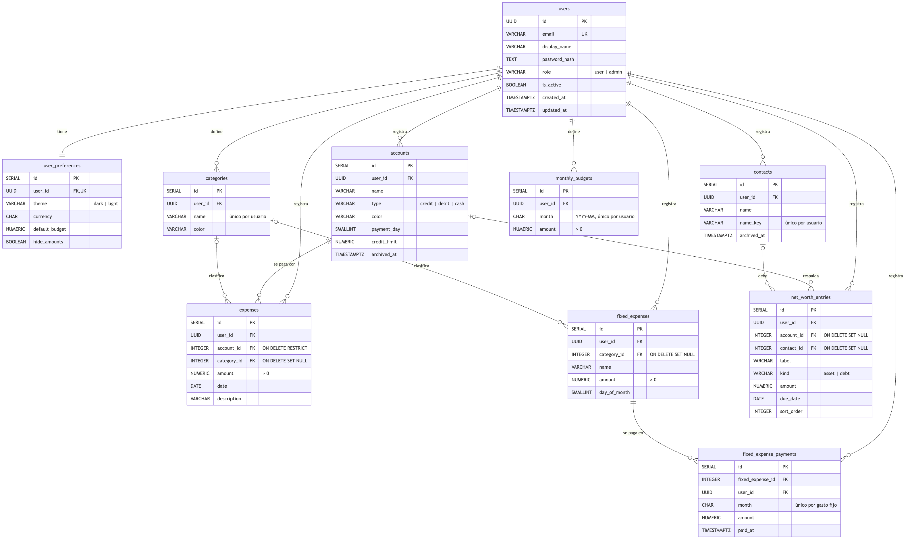
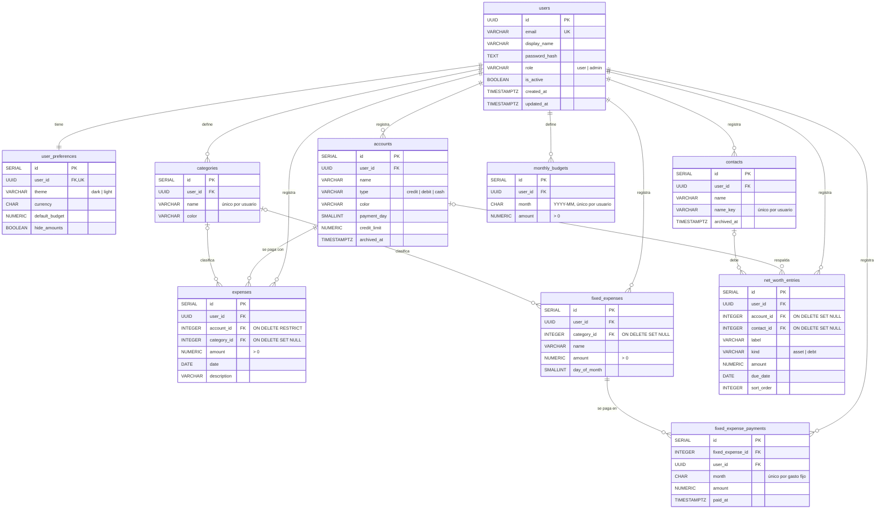

# Modelo entidad-relación

Diagrama del modelo relacional definido en `database/schema.sql` (PostgreSQL). La imagen `modelo-er.png` se generó a partir de este mismo diagrama.

## Reglas de integridad

- Todas las tablas cuelgan de `users` con `ON DELETE CASCADE`: al eliminar un usuario se borra toda su información.
- Una cuenta con gastos no se puede eliminar (`ON DELETE RESTRICT`); la API responde 409 y sugiere archivarla.
- Al eliminar una categoría, sus gastos quedan sin categoría (`ON DELETE SET NULL`).
- `CHECK` en montos, roles, tipos y formato de mes; `UNIQUE` en correo, presupuesto por mes, pago por mes y nombres por usuario.
